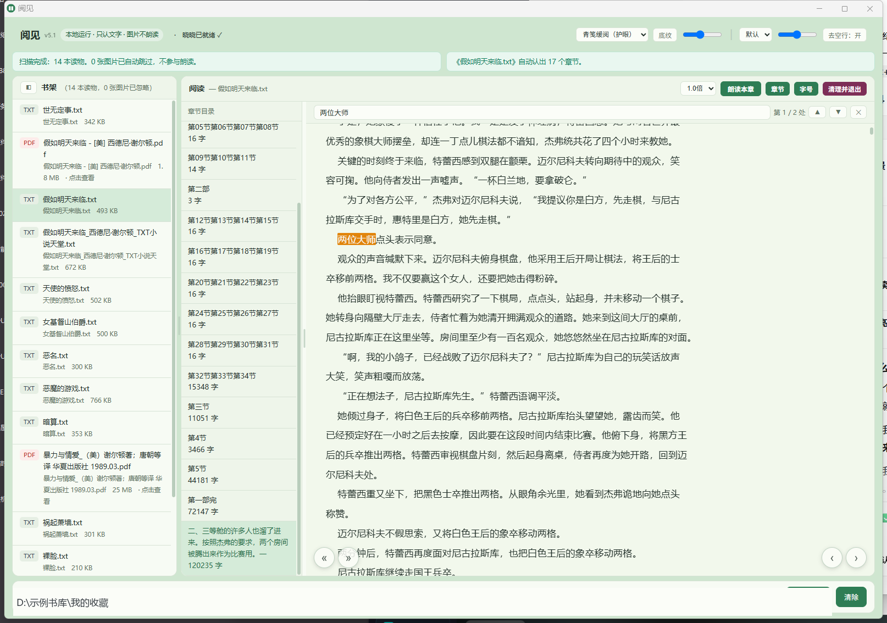
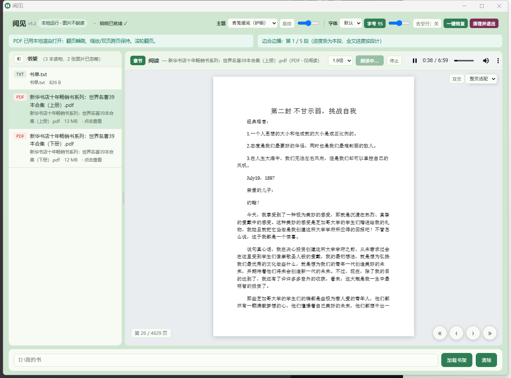
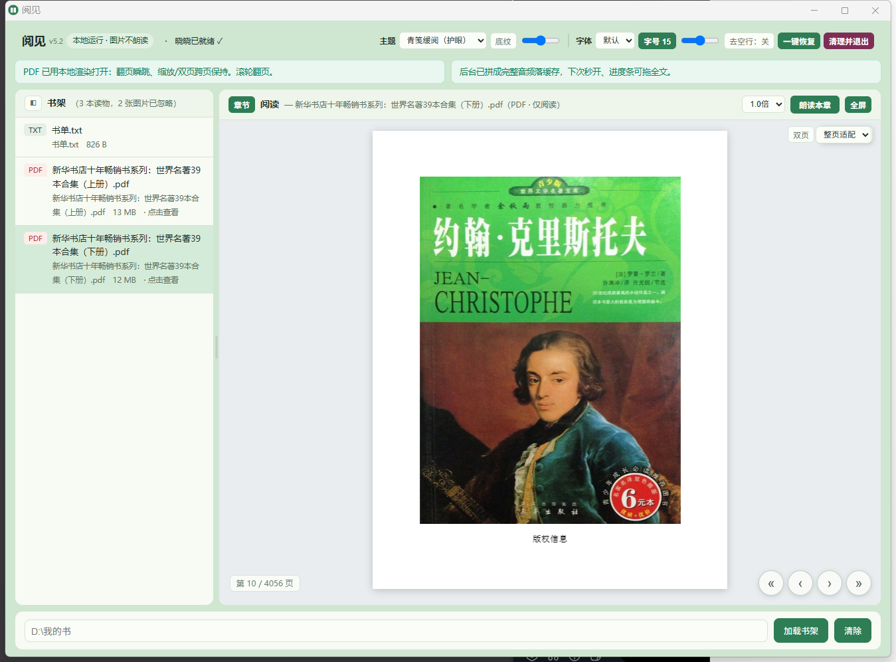
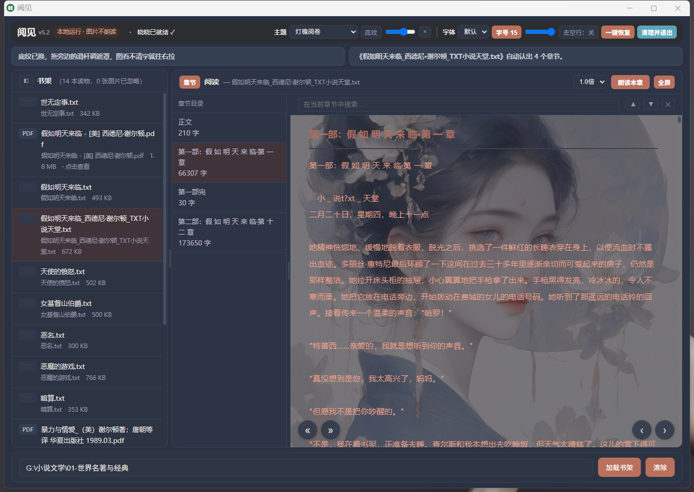

# 阅见阅读器

> 别称：阅见书屋

一个跑在本机的文字阅读器：把一整个文件夹的书自动收进书架，认好章节，点开就读，还能用微软晓晓朗读。书和进度都在你自己电脑上，不上传云端；仅朗读（当前章节文字送微软合成）与划词翻译（选中的几个词送腾讯翻译）在明确操作时把对应文字送出去，不上传整本书。

界面是一个没有地址栏的独立小窗口，像本地软件，不像网页。

---

## 请我喝杯咖啡 ☕

如果「阅见」读着顺手、听着舒服，想支持下作者的话，可以扫下面这个码请我喝杯咖啡——**纯属心意，不打赏也照样随便用，功能一分不少。**

<div align="center">


*微信扫码 · 金额随意*

</div>

---

## 下哪个包？轻量版 vs 完整版

| | **轻量版**（推荐熟手） | **完整版**（含环境，推荐新手） |
|---|---|---|
| 里面有什么 | 只有程序代码 | 程序代码＋内置 Python 3.12.9＋三步安装脚本＋配套底纹包 |
| 还需要装什么 | 自己装 Python，朗读还要双击「一键安装朗读组件.bat」 | 基本不用装，跟着说明走三步就能开 |
| 体积 | 很小（几百 KB） | 大（内置环境，几十 MB 起） |
| 适合谁 | 电脑上已有 Python、或愿意自己装的人 | 没装过 Python、想解压就能用的人 |

> 拿不准就下完整版，开箱即用；介意体积、动手能力强就用轻量版。

---

## 界面长啥样



书架 / 章节 / 正文三栏一目了然，搜索命中橙色高亮；左下角 `« »` 一键到首尾屏，右下角 `‹ ›` 整屏翻页。

---

## 好在哪

- **简单便捷**：不用注册、不用登录、不用选配置。粘一个文件夹路径，点「加载书架」，书就全进来了。只需本机有 Python 环境（只用阅读不朗读的话，装 Python 就行，不用再装别的）。
- **界面美观、分布合理**：书架 / 章节 / 正文三栏一目了然，宽度都能拖，像资源管理器一样顺手。整页锁在一屏里，不用来回滚来滚去。八套主题随挑。
- **功能不多，但够用**：不堆没用的东西。读、找、听、记进度——该有的都有，不该有的一个不放。
- **能朗读**：用和 Edge「大声朗读」一样的晓晓音色，点一下就念，语速 0.6～2.0 倍八档可调，进度条能拖，听着舒服。

---

## 和 v5.0 比，升级了什么

一句话：v5.0 是"能用的阅读器"，v5.1 是"读着顺、听着快、翻页不卡"的阅读器。界面没大改，动的都是每天真会碰到的地方。

| 升级点 | 实际变化 |
|---|---|
| 加载书架 | 「浏览」「加载书架」合成一个按钮，点一下弹窗选目录，选完自动装书架 |
| 首尾页浮钮 | 正文左下角 `« »`，一键到本节开头 / 当前章最后一屏 |
| 字号五档 | 三档扩到五档（13 / 15 / 17 / 19 / 22px），默认 15px |
| MD 语法渲染 | md 正文的标题 / 列表 / 表格 / 加粗 / 代码按格式显示，不再是一坨纯文本 |
| 主题换新名 | 五套主题换成青笺缓阅等雅名，只换招牌不换配色，老配置不丢 |
| TXT 去空行 | 顶栏开关，一键压掉网络小说多余空行，不动原始书 |
| 文字明暗 | 顶栏滑杆调正文文字深浅，每套主题各记各的 |
| 正文字体 | 宋 / 楷 / 仿宋 / 黑体可选，缺字自动回退，每套主题各记各的 |
| 边合边播 | 首段约 12 秒出声就开念，后台接着合；同章同语速下次秒开；换语速掐掉旧任务 |
| PDF 本地渲染 | 翻页从"整本重载、卡"变成"瞬跳"，滚轮按页翻、缩放 / 双页跨页保持，打不开自动退回内建阅读器 |
| 顺手修复的老毛病 | 修复弹窗置顶——选目录 / 选图弹窗不再躲到主窗后面（系统级置顶，实测验到置顶标志生效）；修复底纹"记住上次选图目录"一直没生效；修复 PDF 四个翻页钮叠在同一个点 |

### 这一版最值得说的几个亮点

不吹参数，说几条真用得上的：

1. **听着不等待**——边合边播，第一次朗读十几秒就出声，不用干等整章合成；合完拼整落缓存，下次同章同语速秒开，进度条还能拖。
2. **PDF 翻页不卡**——本地渲染，按钮翻页瞬跳、滚轮按页翻，缩放和双页视图翻页后还在，大扫描版也不拖。
3. **四个"每主题各记各的"**——底纹图、底纹遮罩、文字明暗、正文字体，切主题整套外观跟着换，切回来原样还在。
4. **不用注册、不用配置**——粘个路径点一下就用；整个文件夹搬到任何盘、改成任何名字，照常能跑。
5. **书和进度都不出本机**——阅读不联网；仅朗读与划词翻译在明确操作时把对应文字送出去（朗读送当前章节文字给微软合成、翻译送选中的 ≤500 字符给腾讯），不上传整本书、不上传书架和进度。

实拍两张——右边开着 PDF（标签注明「仅阅读」），顶部朗读条是**同时还在听另一本书**（进度 0:22 / 6:54，PDF 本身不朗读）；顶部提示「后台已拼成完整音频落缓存，下次秒开、进度条可拖全章」：



PDF 本地渲染的阅读视图，右下角是四个翻页钮（`« ‹ › »`），页码 14 / 4629，右上角可切双页 / 整页适配：



---

## 和 v5.2 比，v5.3 改了什么

**升级了什么**

| 升级点 | 实际变化 |
|---|---|
| 行宽跟随窗口 | 正文行宽不再锁死在固定宽度——拖拽窗口边缘改大小，文字行宽实时跟着正文框变；字号调大调小，行宽照样贴着框走 |
| 字号六档＋加粗 | 字号档位 13–22px 五档 → 15–25px 六档（15/17/19/21/23/25，默认仍 15px）；新增「加粗」按钮（全局开关，正文一键加粗，重启保持） |
| 窗口尺寸记忆 | 每次启动恢复上一次的窗口大小，不再回到默认尺寸。拖成多大，下回就按多大开 |

**技术上**

- 正文与引导页的排版容器改为自适应宽度（原来写死 `max-width:900px`，窗口再宽行宽也不动）
- 新增窗口尺寸上报接口：前端拖拽防抖上报，尺寸落盘 `state.json`，启动时读取并按记忆尺寸打开（异常值自动回退默认）
- 修复隐患：原状态保存是整体覆盖式，会把已记的窗口尺寸冲掉——改为覆盖时保留尺寸字段

---

## 和 v5.1 比，v5.2 改了什么

**升级了什么**

| 升级点 | 实际变化 |
|---|---|
| 顶栏重排 | 主题、底纹、字体、字号、明暗滑杆集中到顶栏一行，一眼找全；窄窗口也排得下 |
| 一键恢复 | 界面调乱一点回默认：主题/字体/字号复原、底纹全清、两根滑杆归中 |
| 全屏改沉浸 | 「全屏」不再只是窗口最大化——藏顶栏、书架、章节目录，正文铺满整窗；再点或按 ESC 还原 |
| 默认字号 | 默认 15px，比原来更贴小说阅读习惯 |

**新增了什么**

- **三套新主题**：「樱吹雪卷」「豆蔻温笺」（女性向粉系两套）＋「青峦染绢」（古风绢纸系，含预置沙洲底纹），主题共八套
- **划词翻译**：选中正文里的外文，点浮出的「译」就地看译文（自动识别语种、翻成中文）；只送选中的那几个词、明确点击才触发，不上传整本书
- **一键安装朗读组件.bat**：双击装好朗读组件，不用敲命令
- **首次使用指南**：第一次打开正文区是一篇专写的引导，只讲当下就能试的功能（原来直接摊 README，排版乱、很多功能没加载书点不动）
- **配套底纹包扩充**：底纹图从 21 张扩到 56 张，按主题分组（樱吹雪卷 10、豆蔻温笺 8、青峦染绢 8、青笺缓阅 10、通用 20），挑图直接按主题找

**修复了什么**

- 修复窄窗口顶栏控件换行挤压（1280 宽度实测一行放下）
- 修复底纹滑杆、字号档位在「一键恢复」后状态不归位的问题
- 修复翻页「吃字」：原来按像素滚一整屏，分界线落在行中间会把一行字切成上下两半；现在翻页落点对齐行首，一行字永远完整（上一页底部宁可留白也不切字）。搜索命中跳页的同类切行一并修复

---

## 功能一览

| 能力 | 说明 |
|---|---|
| 自动认章节 | txt / md / epub 自动识别「第X章」等常见标题，生成左侧目录 |
| 内置 PDF | 本地渲染（pdf.js），按钮翻页瞬跳、滚轮按页翻、缩放/双页跨页保持；大文件分段加载，打不开时自动回退内建阅读器 |
| 晓晓朗读 | 微软 `zh-CN-XiaoxiaoNeural`，单章朗读，八档语速，可暂停、拖进度、存 mp3；**边合边播**——首段出声即开播，后台续合，拼整后落缓存下次秒开；换语速立即掐掉旧任务 |
| 正文搜索 | 在当前章节里搜关键词，全部高亮，上下跳转，显示第几处 |
| 翻页阅读 | 正文像书一样整屏翻：`←` `→` 方向键或右下角浮钮翻一屏；搜索命中按屏跳转，当前命中橙色高亮 |
| 首开引导 | 第一次打开自动把使用说明摊在正文区，读完加载书架即可，老用户不受影响 |
| 进度记忆 | 记住上次读的书、读到的章节、窗口布局、主题，下次打开自动还原 |
| 八套主题 | 青笺缓阅（护眼）、墨窗夜读、灯檐阅卷、故纸余温、云宣净页、樱吹雪卷、豆蔻温笺（女性向两套）、青峦染绢（古风） |
| 底纹自定义 | 正文可换你自己的图片当底纹（点顶栏「底纹」选图），滑杆调遮罩浓度保文字可读；每个主题各记各的图，切主题自动跟着换 |
| 正文外观 | 字体可选（默认/宋/楷/仿宋/黑体，缺字自动回退），文字明暗滑杆可调；跟底纹一样每个主题各记各的 |
| TXT 去空行 | 顶栏「去空行」开关，一键压掉网络小说多余空行，保留段落感；不影响原始书文件 |
| 划词翻译 | 书里偶尔夹外文：选中文字，点浮出来的「译」，译文气泡就地显示（自动识别语种，翻成中文）；只送选中的那几个词、明确点「译」才触发，不上传整本书；TXT/MD/EPUB 正文可用 |
| 自由分栏 | 书架和章节栏可拖宽度，也能收起腾地方，宽度自动记住 |
| 加载书架 | 点「加载书架」弹 Windows 原生「选择文件夹」窗口，选中确定后自动装书架，比手填省事 |
| 文件夹搬家 | 整个文件夹搬到任何盘、改成任何名字，照样能用 |

**它不做什么**：图片不朗读、PDF 不朗读（扫描版没有文字层）、不上传整本书、不收集阅读数据。阅读本身不联网；**两个明确操作需要联网**——朗读（当前章节文字送微软合成语音）与划词翻译（选中的 ≤500 字符送腾讯翻译），其余一概不出门。

---

## 快速开始

### 1. 环境

- Windows 10 / 11（界面用 Edge 独立窗口；Windows 7 没有新版 Edge，会自动退回默认浏览器开网页版，功能不变）
- Python 3.8 及以上（启动脚本优先找 `py` 启动器；含环境完整版已内置 3.12.9，无需自装）
- 朗读功能需要 `edge-tts`（**7.3.1 及以上**；微软在 2026-10-13 改了鉴权，老版本会被拒 403）

**装朗读组件最省事的法子**：双击工具文件夹里的 **`一键安装朗读组件.bat`**——自动检测 Python、自动装组件（国内走清华镜像，失败自动换官方源）、自动核对版本，装完显示「朗读组件就绪」。已装过的再双击也只核对一遍，没有副作用。

手动装也可以（效果一样）。朗读组件安装一次即可：

```
py -m pip install "edge-tts==7.3.1"
```

国内网络可用镜像：

```
py -m pip install "edge-tts==7.3.1" -i https://pypi.tuna.tsinghua.edu.cn/simple
```

只用阅读、不朗读的话，这步可以跳过。

### 2. 启动

双击 `启动工具.bat`。

黑窗口一闪而过，服务在后台跑，随后弹出一个没有地址栏的独立窗口——那就是阅读器，在里面操作就行。

### 3. 退出

三种方式，分工不同：

- **点窗口右上角 ✕**——日常关法。窗口一关，后台服务约 2 分钟内自动退场。**音频缓存保留**：下次对同一章、同一语速点「朗读本章」，直接秒开，不用重新生成
- **点「清理并退出」按钮**——立即退场，并且**清空音频缓存**（浏览器临时配置两种方式都会清）。想给磁盘减负、或确定不再回头听，用这个。它是主色的补色按钮，一眼能认出来
- **双击 `退出工具.bat`**——兜底手段，效果等同「清理并退出」，窗口僵死时用

一句话记：**✕ 关窗留缓存，「清理并退出」清干净**。缓存都在工具目录的「音频缓存」文件夹里，随时也可以手动删，不动你的原始书。

---

## 怎么用

1. 把要读的 txt / md / epub / PDF 放同一个文件夹
2. 在底部路径框粘这个文件夹路径，或点「加载书架」弹窗选目录，选中后自动装书架
3. 左边选一本书，中间自动列出章节
4. 点某章看正文
5. 想听就点右上「朗读本章」，语速在旁边的下拉框里调
6. 搜索框输入关键词，正文里高亮所有命中，`▲ ▼` 上下跳
7. 正文按 `←` `→`（或右下角 `‹ ›` 浮钮）整屏翻页，左下角 `« »` 一键到本节开头 / 当前章最后一屏，不用拖滚动条

一些顺手的小动作：

- 正文太窄：点「收起书架」或「章节」把栏收起来，左缘留 `»` 一键展开
- 字太小 / 太大：**加载书架、点开某章正文后**，点「字号」循环切换六档（15 / 17 / 19 / 21 / 23 / 25px，默认 15px，重启保持上次设定），旁边「加粗」按钮一键正文加粗。字号只作用于文字正文（TXT / MD / EPUB），开着 PDF 时对 PDF 页面无效——PDF 用它自己的缩放控件。
- 换口味：右上角主题下拉，八套随挑，选择自动记住
- 播放中想换语速：随时换，当前章节会按新语速重新生成并接着播，不用重来

音频存在本目录的「音频缓存」文件夹，随时可删，不动你的原始书。

---

## 支持哪些文件

| 类型 | 阅读 | 认章节 | 朗读 |
|---|---|---|---|
| txt / md / epub | ✅ | ✅ | ✅ |
| PDF | ✅（窗口内嵌、可翻页） | — | ❌ |
| 图片 | 忽略 | — | ❌ |

---

## 文件夹可以搬家

整个文件夹可以剪切、复制到任意盘、任意路径，改名字也行。启动脚本用相对路径找文件，搬家后照常双击 `启动工具.bat` 就能用。

书架路径、阅读进度、栏宽、主题都记在 `state.json` 里，跟着文件夹一起走，不会丢。

---

## 配套底纹包

暗主题配一张古风仕女底纹的样子，顶栏还能看到「底纹」「字体」两个滑杆调遮罩和明暗：



随工具一起发布的「底纹包」文件夹里有 56 张精选底纹图，全部按 `底纹-序号-材质名.jpg` 命名，按主题分组，挑图不用猜：

| 组 | 张数 | 适合 |
|---|---|---|
| 通用底纹 | 20 张（暖白云石、牛皮纸、素白宣纸、藏青麻布、玄黑细纹等） | 八套主题都能用，亮暗各有对应 |
| 樱吹雪卷 | 10 张樱粉系（樱粉心映、淡樱云霞、珊瑚樱心等） | 樱吹雪卷主题 |
| 豆蔻温笺 | 8 张豆沙粉系（豆蔻金绸、赤豆笺、豆沙晕染等） | 豆蔻温笺主题 |
| 青峦染绢 | 8 张古风绢纸系（绢底祥云、月白绢丝、淡墨远山等） | 青峦染绢 / 故纸余温 |
| 青笺缓阅 | 10 张青绿水彩系（青波淡雾、青碧涟漪、青溪春晓等） | 青笺缓阅 / 云宣净页 |

**用法**：点顶栏「底纹」→「选图」→ 到底纹包文件夹里挑一张 → 确定，再用滑杆把遮罩调到文字清晰为止。每套主题各记各的底纹，切主题自动跟着换；点底纹弹窗里的 `×` 可撤销回纯色。

---

## 快捷方式图标包

「快捷方式图标包」文件夹里有 6 个 `.ico` 图标（`图标-01-古风仕女` ～ `图标-06-阅读器`），挑一个顺眼的给阅读器当桌面图标。其中 `图标-06-阅读器.ico` 是为本工具设计的，推荐用它。

**给自己做个桌面图标，全步骤**：

1. 打开工具所在文件夹，**右键** `启动工具.bat`
2. 选 **「发送到」→「桌面快捷方式」**，桌面上出现一个快捷方式
3. **右键**这个快捷方式 → **「重命名」**，改成你喜欢的名字（比如「阅见书屋」）
4. **右键**快捷方式 → **「属性」**
5. 在「快捷方式」选项卡里点 **「更改图标」**
6. 弹窗提示该文件不含图标、点「确定」继续（这是 Windows 对 .bat 文件的常规提示，正常）
7. 点 **「浏览」**，找到 `快捷方式图标包` 文件夹，选中想要的那个 `.ico` 文件 → **「打开」**
8. 选中图标 → **「确定」→「应用」**，桌面上快捷方式的图标立刻换好

**注意**：图标文件是从 `图标-06-阅读器.ico` 这样的文件里读出来的，改名或移动「快捷方式图标包」文件夹后，桌面图标可能显示空白——把图标文件夹和工具放在一起别分开，或者换图标时重新「浏览」指一次即可。

---

## 技术构成

- 后端：Python 标准库 `http.server`，单文件 `tool.py`，零第三方依赖（朗读组件 edge-tts 除外）；需本机装有 Python 3.x
- 前端：原生 HTML / CSS / 无框架 JavaScript，单文件 `index.html`
- 朗读：edge-tts 调用微软在线语音，**需要联网，仅把当前章节文字送出去合成，不上传整本书、不上传书架和进度**；划词翻译同理，仅把选中文字（≤500 字符）送腾讯翻译
- 窗口：Edge `--app` 极简模式，独立配置目录，退出即清理
- 音频与 PDF 用 HTTP Range 分段传输，边下边播、可拖动

---

## 更新日志

- **v5.3（20261128）**：**升级**——行宽自适应（正文/引导页排版容器 `max-width:900px` → 跟随容器，拖窗口、改字号行宽实时跟随）、窗口尺寸记忆（前端 resize 防抖上报 → `state.json` 落盘 → 启动按记忆尺寸打开，范围校验异常回退 1280×860）、字号六档（13–22 五档 → 15/17/19/21/23/25 六档，默认仍 15px，重启保持上次设定）、正文加粗按钮（全局开关，重启保持，与字号记忆同链路落盘）；**修复**——状态整体覆盖会冲掉窗口尺寸（覆盖时保留 `win_w/win_h`）
- **v5.2（20261122）**：**升级**——顶栏重排（主题/底纹/字体/字号/明暗集中一行）、新增「一键恢复」（复原主题字体字号、清底纹、滑杆归中）、全屏键改为正文沉浸视图（藏顶栏书架只留正文，ESC 还原）、默认字号 15px；**新增**——三套主题（樱吹雪卷、豆蔻温笺、青峦染绢，共八套）、划词翻译（选中点「译」就地出译文，只送选中文字≤500字符、明确点击才触发）、一键安装朗读组件.bat、首启专写《首次使用指南》（替代原来直接摊 README）、底纹包 21→56 张按主题分组；**修复**——窄窗口顶栏换行挤压、一键恢复后底纹/字号状态不归位、**翻页吃字**（按像素滚屏会把行切成两半，改为对齐行首、搜索跳页同修）；**兼容性**——三个 .bat 统一 GBK+936 代码页（中文英文系统都不乱码）、标明 Python 3.8+ 与 Win7 退回默认浏览器行为
- **v5.1（20261122）**：「浏览」「加载书架」合并为一个按钮；新增首页/尾页浮钮（正文）与 PDF 四钮翻页；字号三档扩五档（13–22px）；MD 文件按语法渲染（标题/列表/表格/加粗/代码）；五套主题换新名（青笺缓阅、墨窗夜读、灯檐阅卷、故纸余温、云宣净页，只改显示名，老用户主题/底纹配置不受影响）；TXT 去空行做成全局开关；正文文字字体可选＋明暗滑杆（每主题各记各的）；朗读改为边合边播——首段出声即开播、后台续合、拼整落缓存，换语速掐掉旧任务；PDF 改用本地 pdf.js 渲染，翻页瞬跳、滚轮翻页、缩放/双页跨页保持，失败回退内建阅读器；顺手修复四个问题——修复底纹选图「记住上次目录」一直没生效、修复弹窗躲到主窗后面（头次在隐藏窗上置顶没用，改系统级置顶后实测验到生效）、修复 PDF 四钮叠点、修复底纹/文字明暗两个滑杆拖不到头（滑杆病根是套了带内边距的按钮样式，滑块活动范围被缩进去了）；说明书按实测纠正——朗读需联网（仅章节文字送微软合成）、需装 Python 与朗读组件、✕ 关窗留缓存
- **v5.0（正式版）**：首开引导页；开源仓库整理（.gitignore、更新日志）；工程文件夹归位；配套底纹包与快捷方式图标包（含使用说明）
- **v4.1（测试版）**：正文翻页（←/→ 翻一屏、搜索命中按屏跳）；书架"清除"按钮（真清空，含恢复记录）；底纹自定义（原纸底）遮罩滑杆修复；主题选择落盘重启保留；退出双轨——✕ 关窗保留音频缓存（下次同章同语速朗读秒开）、「清理并退出」清空缓存；朗读自动重试＋多段并行提速（5000 字 79s→31s）；按钮色统一，清理按钮用主色补色一眼可辨
- **v4.0（测试版）**：浏览选目录弹系统文件夹窗口；纸底（后改名底纹）自定义图片＋按主题记忆＋遮罩滑杆
- **v3.x**：版本号进标题条、三栏文案调优、自动恢复记录重置、去滚动条
- **v1.0～v2.1**：书架/章节/正文三栏架构、章节识别、晓晓朗读、内嵌 PDF、搜索高亮、进度记忆、五套主题、自由分栏

---

## 开源协议

MIT。可自由使用、修改、分发，只需保留版权声明。
